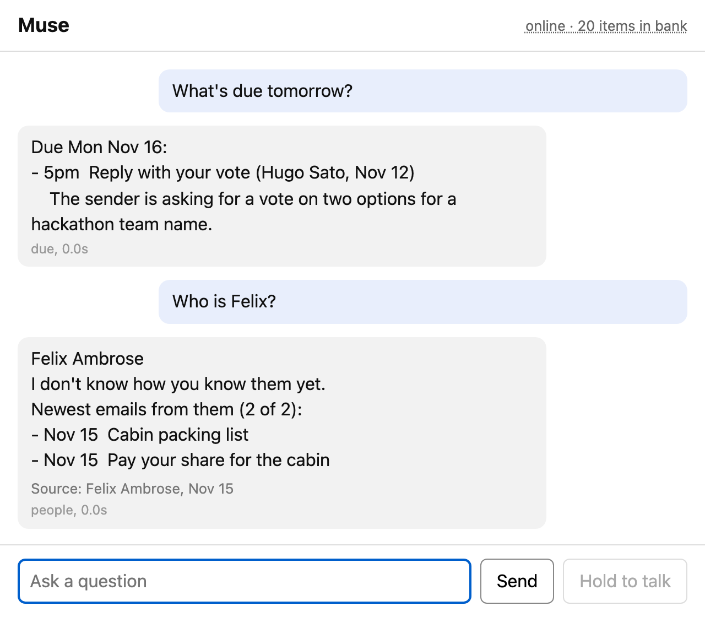
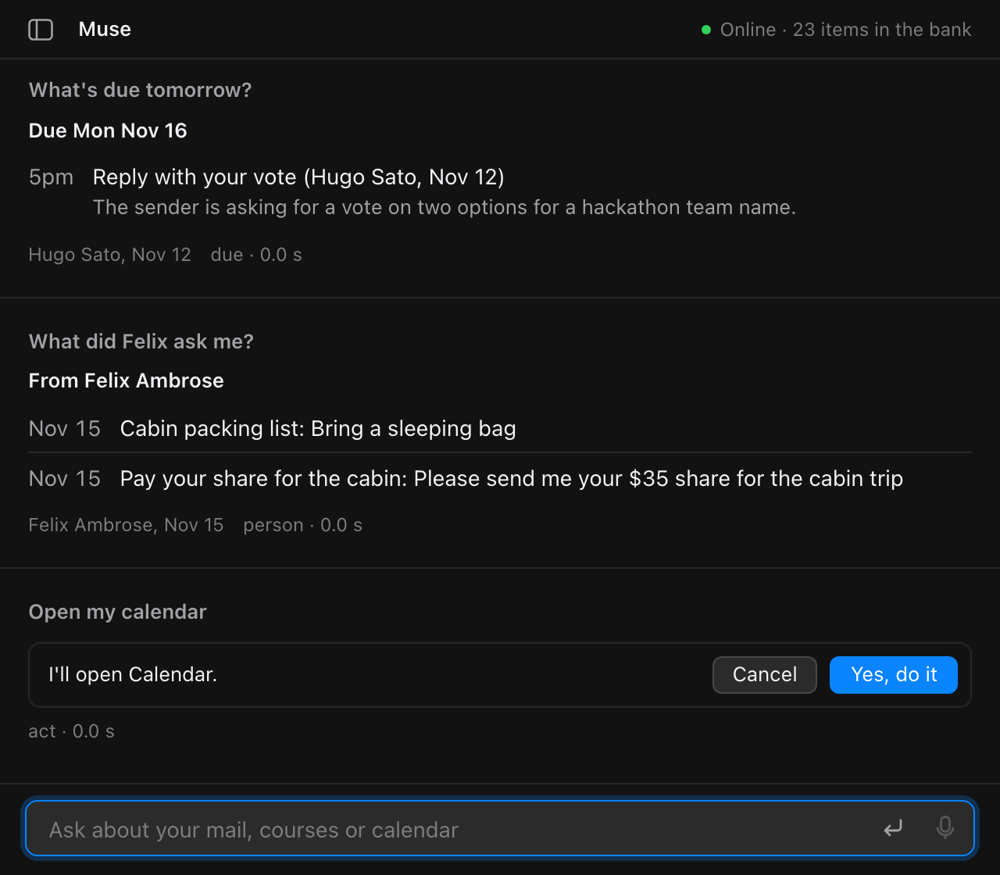
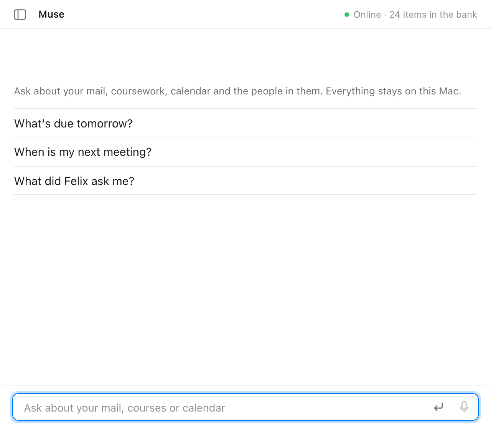
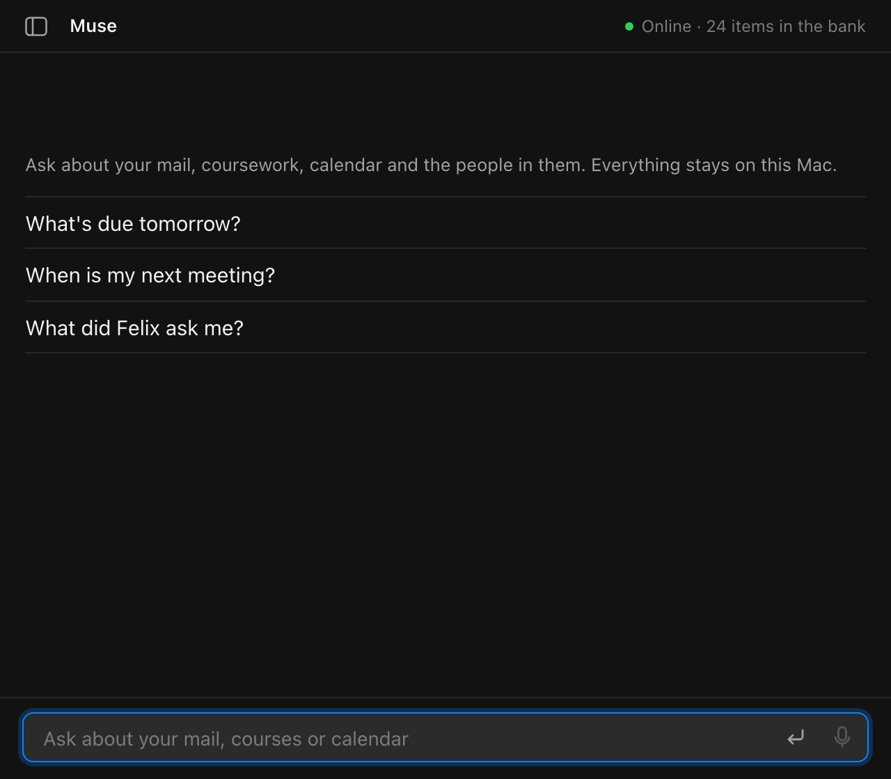
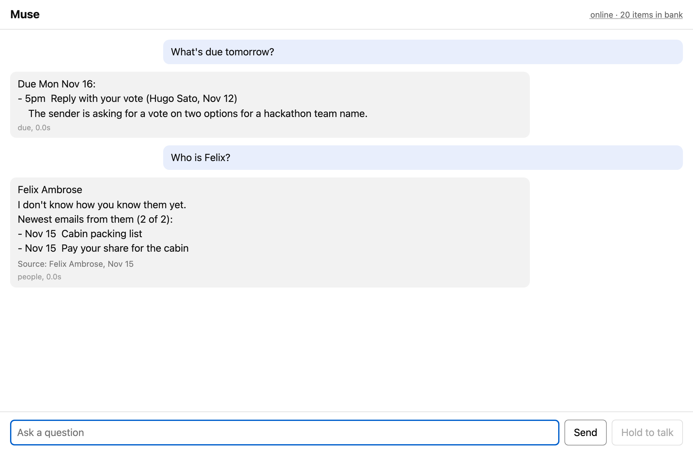
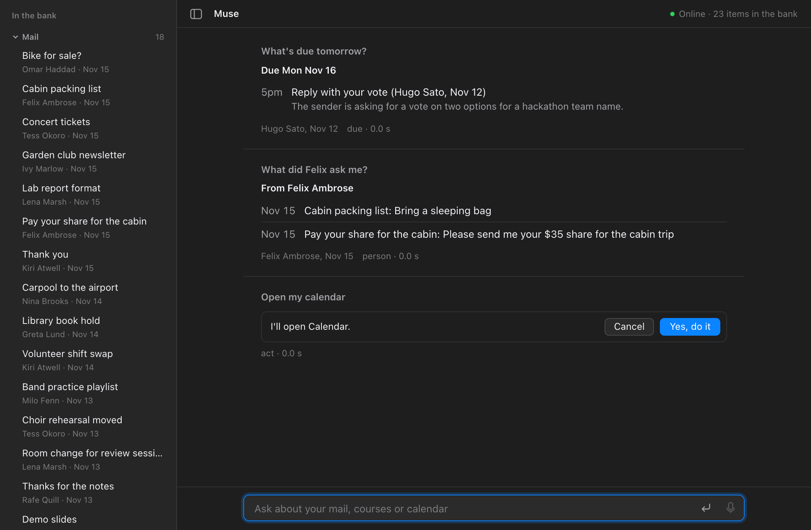

# The window

The chat page (`reason/web.py`) and the Mac app that shows it.

## The page

`python -m reason.web` serves one page (`PAGE` in `reason/web.py`): HTML, CSS and a small script, with no frameworks and nothing loaded from the internet. It opens and works with the network blocked.

### Layout

- **Bar:** a sidebar button, the name, and one status line on the right (online or offline, items in the bank). Clicking the status line shows the bank.
- **Conversation:** it reads like a document. Each question is a small grey line, and the answer is plain text under it. Answer lines of the form `- when  what` (two spaces) become a table with the dates aligned. Other `- ` lines become a list. A short line ending in `:` becomes a heading. An indented line becomes a note under the row above it.
- **Under each answer:** a muted line with the source and the route and time. A bank source opens that entry in the sidebar. A web source opens the page.
- **Actions:** when `/ask` returns `pending`, the first line of the answer (what will happen) and **Cancel / Yes, do it** sit in one row under the answer. The result replaces the buttons in that row. Escape is Cancel.
- **Discover:** the Discover button in the top bar sends `discover` to `/ask`. While a discovery question is held, `/ask` returns `choices` and the answer gets **Yes / No / Skip / Stop** buttons; each reply (and the next question) is a new turn. Escape is Stop. See `playbooks/discover.md`.
- **Sidebar:** the bank, grouped into Mail, Coursework, Notes about you and People. Each group collapses. Clicking an item shows its summary, ask and due dates. Clicking a person asks "Who is …?". People are the senders of mail in the bank.
- **Empty state:** three example questions from the playbooks (due, calendar, person). Clicking one asks it.
- **Input:** one text field with a send button and a talk button. Return sends.

### Talk

The talk control has three states:

| state | how it looks |
|---|---|
| idle | mic icon |
| listening | red level bars and "Listening". The field says "Listening — release to ask" |
| working | spinner while the words are written down |

Hold the mic button, or hold **⌥ (Option)** on its own, to talk. Release to ask, and the transcript appears as the question with a small mic before it. Escape while listening cancels it, and nothing is asked. The voice code returns the words only on release, so the window shows the level bars rather than live words.

Keyboard focus goes back to the text field after every action, except while listening. Errors say what happened and what to do, in one line, where they happened.

### Sizes

- **Wider than 760 px:** the sidebar sits beside the conversation. The sidebar button hides it, and the window remembers that.
- **760 px or narrower** (the ~640 pt hotkey panel): the sidebar slides over the conversation. The page background is transparent, so the panel's system material shows through.
- The conversation column is at most 680 px wide and centred at full screen.

Colours follow the system's light and dark modes. The only accent is system blue, used for the Yes button, a selected bank item and the focus ring.

### Hooks for other code

Keep these working:

- `#q` (the text field), `#send`, `#talk`, `#status`.
- `window.museTalk.start()` / `window.museTalk.stop()`: start and stop listening, the same as holding and releasing the talk control. These are for the Mac app's hotkey.
- `window.museFocus()`: puts the cursor in the text field (it does nothing while listening).
- `POST /ask` → `pending: true` shows Cancel / Yes. Yes and Cancel send `yes` / `no` to `/ask`.
- `POST /ask` → `choices: [[label, word]]` (discovery) shows those buttons instead; each sends its word to `/ask`. `#discover` is the Discover button.
- `GET /bank` rows carry `folder` (course, person, other, me) and `id`, which the sidebar groups by and the source line links by.

### Before and after

At the 640 pt panel size, light and dark (the before shots are from before the redesign):

| | light | dark |
|---|---|---|
| before |  |  |
| after |  |  |
| after, empty |  |  |

Full width, with the bank sidebar:

| | light | dark |
|---|---|---|
| before |  |  |
| after |  |  |

The approved mock is `window/mock.html`, with its screenshots in `window/mock-*.png`.

### Checks

- `uv run python -m pytest reason/tests/test_web.py`: the page loads nothing remote, the hooks are present, and the `/bank` rows include folder and id.
- Network blocked: run the server under `sandbox-exec` with outbound network denied except localhost, then open the page and ask a question. The browser's network log shows only `localhost` requests.


## Mac app (menu bar + Fn-Space)

`app/` holds a small native app, **Muse.app**. It sits in the menu bar and shows the same local page (`python -m reason.web`, :8765) in a floating, Spotlight-style panel. It has no answer logic of its own.

### Build and run

```bash
app/build.sh                 # -> app/build/Muse.app, ad-hoc signed, ~10 s
open app/build/Muse.app
```

The build records the main checkout (`~/code/ai-hackathon-26`) as the folder it runs the servers from, because the Bonsai models live only there. `MUSE_REPO=<folder>` at build or launch time points it somewhere else. Keep that checkout on current `main`, with `voice/swift` built (`swift build -c release`).

### Using it

- **Fn-Space, tap** (Fn = the Globe key): shows or hides the panel, with the cursor in the question box. Escape or clicking another app hides it.
- **Fn-Space, hold:** push to talk. It records while held and stops on release; the panel shows the transcript and the answer. It calls the page's own talk start and stop (`window.museTalk.start()/stop()` when the page has them, else the "Hold to talk" button).
- **Menu bar** (waveform icon): Open, Sync mail (`scripts/sync_email.py 7`; the last result shows under it), Discover (presses the page's Discover button), Check setup, Set Argmax key…, Quit Muse.
- The hotkey is two constants at the top of `app/Muse.swift` (`hotKeyCode`, `hotKeyFlags`). The system hotkey call ignores Fn, so Muse reads the keyboard with an event tap, which needs **Accessibility** for Muse. It swallows Fn-Space, so no space reaches the app in front.

### First launch (once, online or off)

1. It asks for the Argmax `ax_` key and keeps it in the login Keychain as **"Muse Argmax key"**. It is never written to the repo, the app or a file. Change it with Set Argmax key….
2. macOS asks for the **microphone**, **Calendar** (Automation) and **Accessibility** (for Fn-Space) for Muse. Allow all three; Accessibility opens System Settings, where you turn Muse on. The hotkey starts working within 2 s, no relaunch. Muse starts the Python server, so macOS charges the microphone and Calendar allows to Muse; asking at launch means nothing asks mid-demo.

### What it does on every launch

1. Reads the key from the Keychain and gives it to the window server it starts as `ARGMAX_API_KEY`. `ARGMAX_MODEL_FOLDER`, `MUSE_BANK_DIR` (default `~/muse-demo-bank`) and `MUSE_CALENDAR` pass through if set.
2. Starts `scripts/serve_bonsai.sh 4B` and `uv run python -m reason.web --no-open` if :8080 or :8765 doesn't answer, and shows "Starting… Bonsai ready · window starting" meanwhile. If one exits, the panel names it and shows the last log lines. Logs: `~/Library/Logs/Muse/`.
3. Checks setup and lists any problem in the panel, one line each with the fix: the key, the Whisper model folder, the `argmax-voice` binary, Bonsai 4B on :8080, voice ready in the window server, microphone allowed, Accessibility allowed, Calendar allowed and the "Muse demo" calendar present, and the checkout not behind `origin/main` (as of its last fetch, no network). All fine: it shows the page.

**After a rebuild:** the app is signed ad hoc, so macOS treats each build as a new app. It may ask for the microphone, Calendar and Keychain again, and Accessibility has to be turned off and on again for Muse. Build once before the demo, then don't rebuild.

**Quit** stops only what Muse started (SIGINT so Python closes voice, then SIGTERM). A Bonsai or window server that was already running stays up.

If the window server was started from a terminal instead, Muse uses it as it is; its voice then depends on that terminal's key and microphone allow, and Check setup says so if voice isn't ready.
